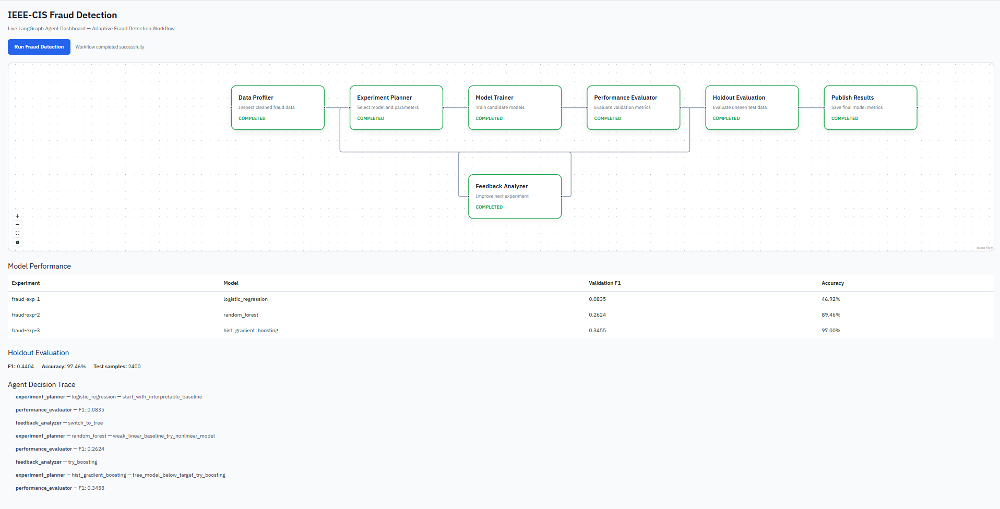

# IEEE-CIS Fraud Detection: Airflow and LangGraph

## Project Overview

This project implements a data engineering and machine learning workflow using the IEEE-CIS Fraud Detection dataset.

It consists of two components:

- **Part 1 — Apache Airflow:** An end-to-end data pipeline for ingestion, cleaning, transformation, PostgreSQL storage, fraud analysis, and metrics publication.
- **Part 2 — LangGraph:** An adaptive machine learning workflow that selects models, evaluates performance, analyzes feedback, and iteratively improves fraud detection results.

Both components are implemented within the AutoML Research Lab environment.

## Dataset

**Source:** IEEE-CIS Fraud Detection (Kaggle)

The project uses two related datasets:

- `train_transaction.csv` — Transaction records, fraud labels, and transaction-related features.
- `train_identity.csv` — Identity-related information associated with transactions.

The datasets are joined using `TransactionID`.

For local experimentation, a stratified sample of 50,000 transactions is used for the Airflow pipeline. The LangGraph workflow uses a separate 12,000-row sample exported from PostgreSQL.

Raw and sampled datasets are excluded from Git version control.

## Part 1: Apache Airflow Pipeline

The Airflow DAG is implemented in:

`lab/airflow/dags/ieee_fraud_pipeline.py`

### Pipeline Tasks

1. `ingest_transactions` — Load transaction records.
2. `clean_transactions` — Validate and clean transaction data.
3. `ingest_identity` — Load identity records.
4. `clean_identity` — Clean identity-related fields.
5. `merge_sources` — Join transaction and identity data.
6. `engineer_features` — Generate features for fraud analysis.
7. `load_postgres` — Store processed records in PostgreSQL.
8. `read_postgres` — Retrieve stored records for downstream analysis.
9. `analyze_fraud` — Train and evaluate a baseline fraud detection model.
10. `publish_metrics` — Publish pipeline metrics.

### Scheduling and Parallel Execution

The Airflow DAG uses a daily schedule (`@daily`) with `catchup=False` to prevent automatic backfilling of historical runs.

Transaction and identity data are ingested and cleaned through two independent branches. Airflow can schedule these branches in parallel when worker capacity permits.

After both branches complete, the pipeline merges the datasets using `TransactionID`, performs feature engineering, and loads the processed records into PostgreSQL. Downstream analysis reads the stored data from PostgreSQL before training and evaluating the baseline model.

### Pipeline Results

| Metric | Value |
|---|---|
| Processed transactions | 50,000 |
| Fraud rate | 3.50% |
| Identity match rate | 24.71% |
| Training records | 40,000 |
| Test records | 10,000 |
| Baseline model | Logistic Regression |
| Accuracy | 0.7594 |
| Precision | 0.0783 |
| Recall | 0.5457 |
| F1 Score | 0.1370 |

The pipeline completed successfully, with all ten tasks executed.

## Part 2: Adaptive LangGraph Workflow

The LangGraph implementation is located in:

`lab/langgraph/ieee_fraud_graph.py`

The workflow includes the following nodes:

- **Data Profiler:** Inspects the fraud dataset.
- **Experiment Planner:** Selects models and experiment configurations.
- **Model Trainer:** Trains candidate models.
- **Performance Evaluator:** Evaluates validation performance.
- **Feedback Analyzer:** Determines how to improve subsequent experiments.
- **Holdout Evaluation:** Evaluates the selected model on held-out data.
- **Results Publisher:** Saves experiment results and decision traces.

### Adaptive Model Selection

The workflow begins with Logistic Regression and adjusts its strategy based on validation results.

| Experiment | Model | Validation F1 |
|---|---|---:|
| 1 | Logistic Regression | 0.0835 |
| 2 | Random Forest | 0.2624 |
| 3 | Histogram Gradient Boosting | 0.3455 |

The workflow stops when the target validation F1 score is reached or the configured maximum number of cycles is exhausted.

### Final Holdout Evaluation

| Metric | Value |
|---|---|
| Selected model | Histogram Gradient Boosting |
| Best validation F1 | 0.3455 |
| Holdout F1 | 0.4404 |
| Holdout accuracy | 0.9746 |
| Holdout records | 2,400 |
| Stop reason | Target reached |

The workflow records model selections, evaluation outcomes, feedback decisions, and stopping conditions.

## Technology Stack

- Python
- Apache Airflow
- LangGraph
- PostgreSQL
- pandas and NumPy
- scikit-learn
- Docker and Docker Compose

## Key Files

| File | Purpose |
|---|---|
| `lab/airflow/dags/ieee_fraud_pipeline.py` | Airflow pipeline |
| `lab/langgraph/ieee_fraud_graph.py` | Adaptive LangGraph workflow |
| `sample_ieee_data.py` | Dataset sampling |
| `test_ieee_agent.py` | LangGraph execution and testing |
| `loop_runtime.py` | Model training utilities |
| `artifacts/ieee_fraud/latest_metrics.json` | Airflow metrics |
| `artifacts/ieee_fraud/agent_results.json` | LangGraph experiment results |
| `artifacts/ieee_fraud/ieee_agent_graph.mmd` | Workflow graph |

## How to Run

Run the following commands from the repository root. The commands below use Git Bash on Windows.

### 1. Prepare the Environment

Requirements:
- Docker Desktop
- Git
- Python with pandas and NumPy
- Access to the IEEE-CIS Fraud Detection dataset

Clone the repository and create the local environment file:

```bash
git clone https://github.com/ZhihaoZhou0/IDS706-Airflow-LangGraph-Fraud-Detection.git
cd IDS706-Airflow-LangGraph-Fraud-Detection
cp .env.example .env
```

### 2. Download and Prepare the Dataset

Download the [IEEE-CIS Fraud Detection dataset](https://www.kaggle.com/competitions/ieee-fraud-detection/data) from Kaggle.

Place these files in `datasets/ieee_fraud/`:

- `train_transaction.csv`
- `train_identity.csv`

Generate a stratified sample:

```bash
python sample_ieee_data.py --sample-size 50000 --seed 42 --chunksize 10000
```

This command creates:

- `datasets/ieee_fraud/sampled/transactions_sample.csv`
- `datasets/ieee_fraud/sampled/identity_sample.csv`

**Warning:** The sampling command overwrites existing sample files. Back up any samples you want to preserve before running it.

### 3. Start PostgreSQL and Airflow

Start the analytics database:

```bash
docker compose -f infra/docker-compose.yml --env-file .env up -d analytics-db
```

Start Airflow:

```bash
docker compose -f infra/docker-compose.yml --env-file .env --profile airflow up -d --build airflow-init airflow-webserver airflow-scheduler
```

Open the Airflow UI:

`http://localhost:8088`

The default development credentials are `admin` / `admin`, unless changed in `.env`.

Locate the DAG named `ieee_fraud_pipeline`, unpause it, and trigger a run manually.

The DAG is also configured with a daily schedule (`@daily`) and `catchup=False`.

### 4. Inspect Airflow Results

After the DAG completes, check the following output:

- `artifacts/ieee_fraud/latest_metrics.json`

The pipeline ingests, cleans, merges, and stores transaction and identity data in PostgreSQL before performing baseline fraud detection analysis.

### 5. Run the Adaptive LangGraph Workflow

After the Airflow DAG has successfully populated PostgreSQL, build the Gateway image:

```bash
docker compose -f infra/docker-compose.yml --env-file .env build gateway
```

Run the LangGraph workflow:

```bash
MSYS_NO_PATHCONV=1 docker compose \
  -f infra/docker-compose.yml \
  --env-file .env \
  run --rm --no-deps \
  -v "$(pwd):/repo" \
  -v "$(pwd)/loop_runtime.py:/app/loop_runtime.py:ro" \
  -e PYTHONPATH=/repo:/app \
  --entrypoint sh \
  gateway -c 'python /repo/test_ieee_agent.py'
```

The workflow reads processed records from PostgreSQL and runs adaptive model experiments.

### 6. Inspect LangGraph Results

The workflow generates:

- `artifacts/ieee_fraud/agent_results.json` — Experiment results and evaluation metrics.
- `artifacts/ieee_fraud/ieee_agent_graph.mmd` — Mermaid representation of the workflow graph.

The recorded experiments evaluate Logistic Regression, Random Forest, and Histogram Gradient Boosting.

### 7. Live Fraud Detection Dashboard

The project also provides an interactive React dashboard that visualizes the adaptive LangGraph workflow in real time.

The dashboard includes:

- **Live Workflow Visualization:** Seven LangGraph nodes with real-time execution status and animated connections.
- **Model Performance:** Validation metrics for Logistic Regression, Random Forest, and Histogram Gradient Boosting.
- **Holdout Evaluation:** Final model evaluation on a separate holdout dataset.
- **Agent Decision Trace:** A chronological record of model selections, evaluation results, and feedback-driven decisions.

To launch the dashboard, first ensure that the PostgreSQL database has been populated by the Airflow pipeline.

Start the Gateway:

```bash
docker compose -f infra/docker-compose.yml --env-file .env up -d --build gateway
```

Start the React frontend from the repository root:

```bash
cd frontend
npm install
npm run dev
```

Open:

`http://localhost:5173/ieee-fraud`

Click **Run Fraud Detection** to execute the adaptive workflow and view its progress.

**Recorded results:**
- Validation F1: Logistic Regression 0.0835, Random Forest 0.2624, Histogram Gradient Boosting 0.3455.
- Final holdout F1: 0.4404.
- Final holdout accuracy: 97.46%.



### 8. Screenshots

Evidence of successful execution is available in the `images/` directory:

- [Airflow DAG Execution](../images/ieee_airflow_dag_success.png)
- [Airflow Run Details](../images/ieee_airflow_run_details.png)
- [Airflow Model Metrics](../images/ieee_airflow_model_metrics.png)
- [LangGraph Workflow Graph](../images/ieee_agent_graph.png)
- [LangGraph Model Metrics](../images/ieee_agent_model_metrics.png)
- [LangGraph Decision Trace](../images/ieee_agent_decision_trace.png)

These screenshots document the completed workflows, model performance, and adaptive experiment decisions.

## Reproducibility Notes

The project runs in Docker-based environments.

The Gateway image includes pandas, scikit-learn, LangGraph, and the PostgreSQL driver `psycopg2-binary`.

Raw datasets are not included in the repository. Users must obtain the IEEE-CIS Fraud Detection dataset separately and prepare the required sample files.

The Airflow and LangGraph components use different sample sizes and evaluation procedures. Their reported F1 scores should therefore not be interpreted as a controlled head-to-head comparison.

## Future Work

The workflow can be extended with multiple specialized agents, adaptive task routing, failure recovery, and an evaluation suite comparing adaptive workflows against fixed Airflow and simple agent baselines.