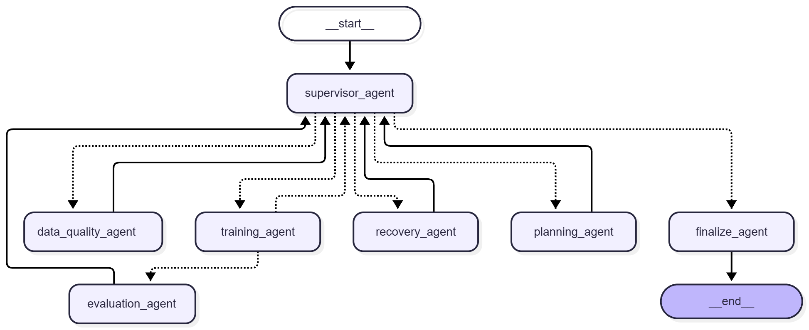
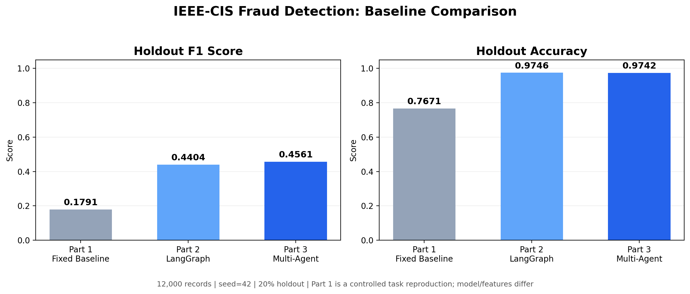
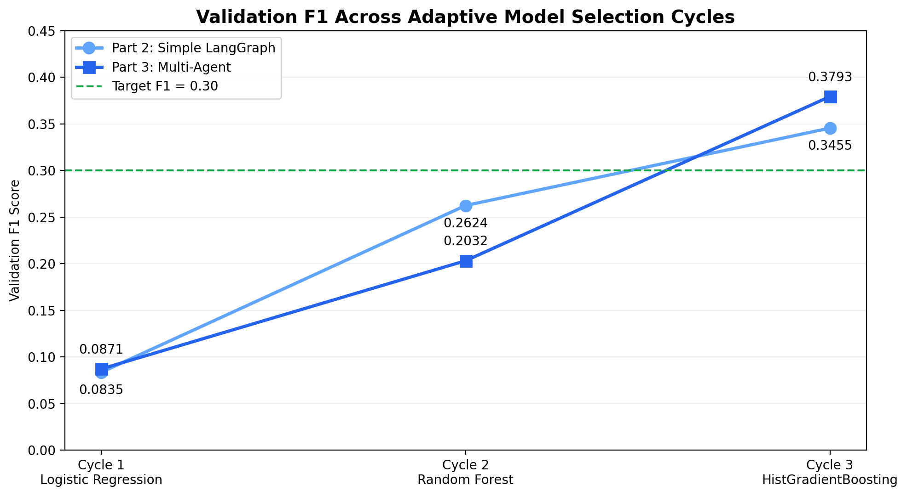

# Part 3: Adaptive Multi-Agent Fraud Detection

**IDS 706 — Optional Super Super Bonus (Up to 25 Points)**

## Project Overview

This project extends the existing IEEE-CIS fraud detection workflow by implementing an adaptive, supervisor-controlled multi-agent system using LangGraph.

The system coordinates seven specialized agents to perform data validation, experiment planning, model training, performance evaluation, failure recovery, and final result generation.

Unlike a fixed workflow, the multi-agent system dynamically selects the next agent based on intermediate results, model performance, and execution failures.

The project also includes an automated evaluation suite, a three-system baseline comparison, and an interactive Streamlit dashboard.

### Key Features

- Supervisor-based multi-agent orchestration
- Dynamic agent routing using LangGraph
- Automated data quality validation
- Adaptive model selection and evaluation
- Failure detection, recovery, and retry limits
- Performance-based stopping conditions
- Automated evaluation with 17 test cases
- Comparison against fixed Airflow and simple LangGraph baselines
- Interactive Streamlit evaluation dashboard

---

## 1. System Architecture

The Part 3 implementation consists of seven specialized agents.

| Agent | Responsibility |
|---|---|
| Supervisor Agent | Coordinates the workflow and selects the next agent dynamically |
| Data Quality Agent | Validates dataset availability and quality before training |
| Planning Agent | Selects model families and experiment configurations |
| Training Agent | Executes model training and validation |
| Evaluation Agent | Evaluates intermediate results and updates workflow state |
| Recovery Agent | Handles training failures and retry operations |
| Finalize Agent | Finalizes execution and performs the held-out evaluation |

### LangGraph Workflow

The workflow uses a supervisor-centric architecture.

The Supervisor Agent dynamically routes execution based on the current state. Other agents return their results to the Supervisor, allowing the workflow to adapt during execution.



The diagram was exported from the actual LangGraph implementation rather than manually constructed.

[View Mermaid Workflow Source](results/workflow_graph.mmd)

### Adaptive Execution

The workflow supports the following behaviors:

1. Validate the input dataset before training.
2. Select an initial model configuration.
3. Train and evaluate the selected model.
4. Compare validation performance against the target.
5. Select another model when further improvement is needed.
6. Route failed training attempts through the Recovery Agent when retries remain.
7. Stop when the target performance is reached, the maximum number of cycles is exhausted, or a terminal failure occurs.
8. Perform final holdout evaluation when a valid model is available.

The workflow supports both simulation and real-training modes.

Simulation mode enables deterministic testing of routing and recovery behavior without requiring repeated model training.

Real mode uses the existing fraud detection dataset and shared model-training utilities.

---

## 2. Dataset and Experimental Setup

The experiments use an existing subset of the IEEE-CIS fraud detection dataset prepared during the earlier project stages.

### Dataset Configuration

| Parameter | Value |
|---|---|
| Dataset | IEEE-CIS Fraud Detection |
| Input file | `artifacts/ieee_fraud/agent_input.csv` |
| Total records | 12,000 |
| Target variable | `isFraud` |
| Fraudulent transactions | 420 |
| Non-fraudulent transactions | 11,580 |
| Random seed | 42 |
| Holdout fraction | 20% |
| Holdout records | 2,400 |
| Primary evaluation metric | F1 Score |
| Target validation F1 | 0.30 |
| Maximum model-selection cycles | 3 |

The dataset is imbalanced, with fraudulent transactions representing approximately 3.5% of the records.

For this reason, F1 Score is used as the primary model comparison metric, alongside accuracy.

The holdout dataset is kept separate from intermediate model-selection evaluation.

---

## 3. Multi-Agent Implementation

The implementation is organized into the following components.

### `multi_agent_graph.py`

Defines the LangGraph workflow, its state, specialized agent nodes, and conditional routing.

The graph coordinates agent execution and records intermediate results, execution history, recovery events, and final outcomes.

### `planner.py`

Implements adaptive routing and model-selection decisions.

The model-selection sequence includes:

1. Logistic Regression
2. Random Forest
3. Histogram Gradient Boosting

The planner can also select an existing best-performing model for refinement after the initial model sequence.

### `data_quality.py`

Performs input dataset validation before real model training.

The workflow can terminate early when required data is unavailable or invalid.

### `real_training.py`

Connects the multi-agent workflow to the existing model-training functionality.

The implementation reuses the project's shared training utilities rather than creating an unrelated machine learning pipeline.

### Failure Recovery

The Recovery Agent supports bounded retry behavior.

When a training attempt fails, the workflow can route execution through recovery and return to the Supervisor for another decision.

If the configured retry limit is exhausted, the workflow terminates according to its stopping rules.

This provides explicit failure-handling behavior beyond a simple fixed execution sequence.

---

## 4. Three-System Baseline Comparison

Part 3 was compared against two earlier workflow implementations.

### Systems Evaluated

**Part 1 — Fixed Airflow Baseline**

A controlled reproduction of the available fixed model-training task from the original Airflow workflow.

This baseline uses Logistic Regression and the features available in the shared exported dataset.

It does not execute the complete original Airflow DAG.

**Part 2 — Simple LangGraph Baseline**

The existing adaptive LangGraph workflow from Part 2.

It performs iterative model selection and evaluation using the original Part 2 implementation.

**Part 3 — Multi-Agent LangGraph**

The new supervisor-controlled system with specialized agents, conditional routing, and recovery logic.

### Holdout Performance

| Metric | Part 1 | Part 2 | Part 3 |
|---|---:|---:|---:|
| Holdout F1 | 0.1791 | 0.4404 | **0.4561** |
| Holdout Accuracy | 0.7671 | **0.9746** | 0.9742 |
| Model-selection cycles | 1 | 3 | 3 |
| Holdout records | 2,400 | 2,400 | 2,400 |



### Results Interpretation

Part 3 achieved the highest holdout F1 Score in this experiment.

Its holdout F1 was approximately 0.0158 higher than Part 2.

However, the results should not be interpreted as proof that the multi-agent architecture alone caused the performance improvement.

The systems differ in model configurations, and Part 1 uses a smaller set of available features. Part 2 and Part 3 also use different hyperparameter configurations for some models.

Therefore, the performance comparison is descriptive rather than a controlled causal evaluation of workflow architecture.

The primary contribution of Part 3 is its explicit multi-agent coordination, adaptive routing, and failure recovery capabilities.

---

## 5. Adaptive Model Selection

Both Part 2 and Part 3 evaluated three model families during their adaptive workflows.

### Validation F1 by Cycle

| Cycle | Model | Part 2 Validation F1 | Part 3 Validation F1 |
|---|---|---:|---:|
| 1 | Logistic Regression | 0.0835 | 0.0871 |
| 2 | Random Forest | 0.2624 | 0.2032 |
| 3 | Histogram Gradient Boosting | 0.3455 | **0.3793** |



Both systems reached the target validation F1 of 0.30 during the third cycle.

Part 2 performed better during the second cycle, while Part 3 achieved a higher validation F1 during the third cycle.

These results demonstrate the recorded model-selection behavior, but they do not independently establish the effectiveness of multi-agent coordination.

---

## 6. Automated Evaluation Suite

The evaluation suite tests intermediate workflow behavior, final execution outcomes, and agent coordination.

Each test specification includes:

- Test identifier and category
- Input state or configuration
- Expected behavior or outcome
- Scoring criteria
- Pass/fail threshold
- Observed test result
- Execution duration

### Evaluation Results

| Test Category | Passed | Total |
|---|---:|---:|
| Agent Routing | 7 | 7 |
| Model Selection | 4 | 4 |
| Workflow Integration | 3 | 3 |
| Data Quality & Safety | 3 | 3 |
| **Total** | **17** | **17** |

**Overall Test Pass Rate: 100%**

### Evaluation Coverage

**Agent Routing**

Tests whether the Supervisor selects the appropriate next agent under different workflow states.

**Model Selection**

Tests the initial model sequence and subsequent model refinement behavior.

**Workflow Integration**

Tests normal execution, successful recovery, and immediate termination when retries are disabled.

**Data Quality and Safety**

Tests missing datasets, simulation execution, and bounded recovery behavior.

### Evaluation Artifacts

- [Evaluation Suite Specifications](evaluation/evaluation_suite.json)
- [Evaluation Summary](results/evaluation_summary.json)
- [JUnit XML Test Results](results/pytest_results.xml)

The evaluation suite uses pytest and structured JSON artifacts.

LangSmith is not required for this implementation.

The automated tests primarily evaluate workflow correctness and coordination behavior. Real-data model quality is reported separately through the baseline experiments.

---

## 7. Interactive Streamlit Dashboard

An interactive dashboard was developed to present the evaluation results and workflow architecture.

### Dashboard Features

The dashboard contains four sections.

**Overview**

Displays overall evaluation pass rate, number of successful tests, Part 3 holdout F1, and number of specialized agents.

**Baseline Comparison**

Displays the three-system comparison table and holdout performance visualizations.

**Adaptive Workflow**

Displays the exported LangGraph workflow, model-selection trends, and validation results.

**Evaluation Suite**

Displays test-category summaries, individual test results, and complete evaluation specifications.

### Running the Dashboard

Run the following commands from the repository root.

Create a virtual environment:

```powershell
python -m venv .venv-dashboard
```

Install the required dependencies:

```powershell
.\.venv-dashboard\Scripts\python.exe -m pip install streamlit pandas matplotlib
```

Start Streamlit:

```powershell
.\.venv-dashboard\Scripts\python.exe -m streamlit run lab/part3/dashboard.py
```

Open the local dashboard:

http://localhost:8501

The dashboard reads saved JSON and image artifacts.

It does not retrain models, modify PostgreSQL, or execute the Airflow pipeline.

---

## 8. Running Automated Tests

The automated tests require the existing project dependencies, including LangGraph and scikit-learn.

They can be executed using the existing Docker gateway image.

From the repository root, run:

```powershell
docker run --rm `
  --entrypoint sh `
  -v "${PWD}:/repo" `
  -w /repo `
  automl-research-lab-gateway:latest `
  -c "pip install --quiet pytest && python -m pytest lab/part3/evaluation/test_planner.py lab/part3/evaluation/test_multi_agent_graph.py lab/part3/evaluation/test_data_quality.py -q --junitxml=lab/part3/results/pytest_results.xml"
```

Expected result for the current implementation:

```text
17 passed
```

### Regenerating Evaluation Reports

After running pytest, regenerate the structured evaluation reports:

```powershell
python lab/part3/evaluation/generate_evaluation_suite.py
```

This updates:

- `lab/part3/evaluation/evaluation_suite.json`
- `lab/part3/results/evaluation_summary.json`

### Regenerating Performance Figures

From the repository root:

```powershell
python lab/part3/evaluation/plot_baselines.py
python lab/part3/evaluation/plot_validation_trend.py
```

These scripts read the saved baseline JSON files and regenerate the performance figures.

They do not retrain the models.

---

## 9. Project Structure

```text
lab/part3/
├── README.md
├── dashboard.py
├── data_quality.py
├── multi_agent_graph.py
├── planner.py
├── real_training.py
├── evaluation/
│   ├── evaluation_suite.json
│   ├── generate_evaluation_suite.py
│   ├── part1_baseline.py
│   ├── plot_baselines.py
│   ├── plot_validation_trend.py
│   ├── test_data_quality.py
│   ├── test_multi_agent_graph.py
│   └── test_planner.py
└── results/
    ├── evaluation_summary.json
    ├── part1_baseline.json
    ├── part2_baseline.json
    ├── part3_baseline.json
    ├── pytest_results.xml
    ├── workflow_graph.mmd
    └── figures/
        ├── baseline_comparison.png
        ├── validation_f1_trend.png
        └── workflow_graph.png
```

---

## 10. Reproducibility and Limitations

The implementation was developed as an extension of the existing IDS 706 project.

The following limitations should be considered:

1. The Part 1 baseline is a controlled reproduction of the available fixed training task, not a complete execution of the original Airflow DAG.
2. The systems use the same exported dataset and holdout configuration, but their model features or hyperparameters are not fully identical.
3. A higher F1 Score does not by itself demonstrate that multi-agent coordination improves predictive performance.
4. Some evaluation tests use deterministic simulation mode to validate workflow behavior.
5. The dashboard presents previously saved experimental results rather than executing the full pipeline interactively.
6. The exported dataset is required to reproduce real-training experiments.
7. The current evaluation reports successful automated tests but does not constitute a comprehensive benchmark of all possible workflow failures.

Future improvements could include additional failure-injection scenarios, runtime comparisons, and repeated experiments across multiple random seeds.

---

## 11. Submission Deliverables

The Part 3 submission includes:

- Supervisor-controlled multi-agent LangGraph implementation
- Seven specialized agents
- Adaptive model selection and conditional routing
- Failure recovery and retry logic
- Workflow graph exported from LangGraph
- Automated evaluation suite with 17 passing tests
- Structured evaluation specifications and JUnit XML results
- Comparison against Part 1 and Part 2 baselines
- Holdout performance and validation trend visualizations
- Interactive Streamlit dashboard
- Setup instructions and reproducibility documentation

**Project:** IDS 706 — Data Engineering Systems

**Component:** Optional Part 3 — Multi-Agent System with Adaptive Graph Workflows and Evaluation
